# BirrStock IMS: Detailed Phased Implementation Plan

This document outlines the step-by-step implementation roadmap for **BirrStock**. The roadmap is structured into **10 granular phases**, broken down into **bite-sized micro-tasks** designed for continuous, incremental delivery, testability, and low-risk releases.

---

## Roadmap Overview

```mermaid
flowchart LR
    P0[Phase 0: Scaffolding] --> P1[Phase 1: Auth & RBAC]
    P1 --> P2[Phase 2: Master Data]
    P2 --> P3[Phase 3: Ledger Engine]
    P3 --> P4[Phase 4: Inbound & PO]
    P4 --> P5[Phase 5: Order Allocation]
    P5 --> P6[Phase 6: Pick, Pack, Ship]
    P6 --> P7[Phase 7: Returns & RMA]
    P7 --> P8[Phase 8: Channel Sync]
    P8 --> P9[Phase 9: Cycle Count & BI]
    P9 --> P10[Phase 10: Hardening]
```

---

## Phase 0: Project Scaffolding & Infrastructure (Sprint 1)
**Goal:** Establish development environments, CI/CD pipelines, containerized databases, and monorepo/service layout.

### Micro-Tasks:
* [ ] **0.1 Development Environment & Containerization:**
  * Configure `docker-compose.yml` with PostgreSQL 16 and Redis 7 (with persistence and password authentication enabled).
  * Set up database volume mounts and local health check scripts.
  * *Verification:* Run `docker compose up -d` and verify connections via `psql` and `redis-cli`.
* [ ] **0.2 Backend Framework Scaffolding (Node.js/NestJS):**
  * Scaffold TypeScript NestJS project with modular directory structure (`/modules/inventory`, `/modules/orders`, `/modules/catalog`).
  * Configure Prisma or TypeORM/Drizzle with database migration automation.
  * Establish global exception filters, standard JSON response interceptors, and DTO validation pipes (`class-validator`).
  * *Verification:* Hit `/health` endpoint returning database and Redis status.
* [ ] **0.3 Next.js Frontend Setup:**
  * Configure Next.js 15+ App Router in `birr-stock/` with Tailwind CSS, Lucide icons, and Shadcn UI component primitives.
  * Set up shared API client (using `ky` or standard `fetch` with error interceptors and session token refresh).
  * Configure PWA manifest (`manifest.json`) and service worker support for offline/warehouse floor resiliency.
  * *Verification:* Next.js runs cleanly on `http://localhost:3000` with dark/light warehouse-contrast styling.
* [ ] **0.4 Code Quality, Git Hooks & CI Pipeline:**
  * Configure ESLint, Prettier, and Husky pre-commit hooks (running `lint-staged` and type checks).
  * Set up GitHub Actions CI workflow to run linting, type checks, and migrations against a test DB on pull requests.
  * *Verification:* Commit a branch and verify automated CI passing.

---

## Phase 1: Security, Auth & RBAC Foundation (Sprint 2)
**Goal:** Implement authentication, multi-role authorization, and foundational immutable audit logging.

### Micro-Tasks:
* [ ] **1.1 Identity & Credential Schema:**
  * Create `users` table (`id`, `email`, `password_hash`, `first_name`, `last_name`, `role_id`, `is_active`, `created_at`).
  * Create `roles` and `permissions` tables with initial seeds: `SUPER_ADMIN`, `OPERATIONS_ADMIN`, `INVENTORY_CONTROLLER`, `WAREHOUSE_OPERATOR`, `PACK_STATION`, `PROCUREMENT`.
  * *Verification:* Run migration and seed script; verify test users in database.
* [ ] **1.2 JWT Authentication & Session Handling:**
  * Implement access token (short-lived 15m) + refresh token (long-lived 7d stored in Redis) authentication flow.
  * Provide Next.js login screen with form validation, error states, and session persistence in secure HTTP-only cookies.
  * *Verification:* Successfully log in, inspect JWT claims, and verify token refresh when access token expires.
* [ ] **1.3 Role Guards & Route Protection:**
  * Create `@Roles()` decorator and `RolesGuard` in NestJS backend.
  * Implement Next.js middleware to redirect unauthenticated or unauthorized users trying to access restricted routes (e.g. `/finance` or `/settings`).
  * *Verification:* Unit test verifying `WAREHOUSE_OPERATOR` is blocked from calling `/api/v1/costs` (403 Forbidden).
* [ ] **1.4 Immutable Audit Logging Service:**
  * Create `system_audit_logs` table (`actor_id`, `action`, `entity_type`, `entity_id`, `diff_json`, `ip_address`, `timestamp`).
  * Implement an asynchronous NestJS interceptor to capture state mutations without adding HTTP response latency.
  * *Verification:* Trigger a user role change and confirm the before/after JSON diff is recorded in the audit log.

---

## Phase 2: Product Master Data & Warehouse Layout (Sprint 3)
**Goal:** Build the complete catalog hierarchy (Products, Variants, Barcodes, Bundles) and physical warehouse location modeling.

### Micro-Tasks:
* [ ] **2.1 Product & Variant Schema & Endpoints:**
  * Implement `products` and `product_variants` tables.
  * Build CRUD endpoints: `GET /api/v1/products`, `POST /api/v1/products`, `POST /api/v1/variants`.
  * Include physical dimensions: `weight_grams`, `length_mm`, `width_mm`, `height_mm`.
  * *Verification:* Postman/curl script creating a parent product with 3 variants (Small, Medium, Large).
* [ ] **2.2 Multi-Barcode Registry:**
  * Create `product_barcodes` table supporting UPC, EAN, and internal Code-128 strings.
  * Implement barcode lookup endpoint `GET /api/v1/barcodes/lookup?code=...` with sub-15ms index response time.
  * *Verification:* Ensure scanning any of 3 distinct barcodes maps back to the single correct `variant_id`.
* [ ] **2.3 Virtual Bundles & Bill of Materials (BOM):**
  * Create `product_bundle_components` mapping table.
  * Add validation logic ensuring a bundle cannot contain itself (prevent circular dependencies).
  * Build calculation helper returning dynamic bundle ATP based on component stock levels.
  * *Verification:* Unit test verifying bundle stock = $\min(\text{Component A}/2, \text{Component B}/1)$.
* [ ] **2.4 Warehouse Location Hierarchy:**
  * Create `warehouses` and `warehouse_bins` tables (`warehouse_id`, `zone`, `aisle`, `rack`, `shelf`, `bin_code`, `is_pickable`).
  * Build bulk location generation script (e.g., generate 500 bin codes for Zone A in standard coordinate format).
  * *Verification:* Run seed script generating Zone A aisles 01-10 with barcodes; verify query indices.
* [ ] **2.5 Next.js Catalog & Location Management UI:**
  * Build product catalog table with pagination, search by SKU/barcode, and variant detail modal.
  * Build interactive warehouse location tree viewer.
  * *Verification:* Associate can search a product by typing or scanning a barcode in the UI search bar.

---

## Phase 3: The Immutable Inventory Ledger & Balances (Sprint 4)
**Goal:** Implement the financial-grade double-entry transaction ledger and balance snapshot engine.

### Micro-Tasks:
* [ ] **3.1 Ledger Table & Transaction Types:**
  * Create `inventory_transactions` table with mandatory fields: `variant_id`, `warehouse_id`, `source_bin_id`, `destination_bin_id`, `delta_quantity`, `reason_code`, `reference_id`, `performed_by`.
  * Define strict enum for `reason_code` (`PO_RECEIPT`, `BIN_TRANSFER`, `ORDER_PICK`, `CYCLE_COUNT_ADJUST`, `RMA_RESTOCK`, `SCRAP_WRITEOFF`).
  * *Verification:* Prevent manual updates/deletes using database triggers or permissions on the ledger table.
* [ ] **3.2 Materialized Balance Sync & Reconciliation:**
  * Create `inventory_balances` table (`variant_id`, `warehouse_id`, `bin_id`, `quantity_on_hand`, `quantity_reserved`).
  * Build `LedgerService.recordMovement()`: Executes an atomic database transaction that appends a ledger row and updates `inventory_balances`.
  * *Verification:* Execute 100 random debit/credit movements; compare `SUM(delta_quantity)` against `quantity_on_hand` to confirm exact match.
* [ ] **3.3 Manual Inventory Adjustments with Reason Codes:**
  * Implement `POST /api/v1/inventory/adjust` with mandatory reason code, reference note, and supervisor approval trigger.
  * Build Next.js Stock Adjustment modal with real-time balance previews.
  * *Verification:* Admin creates an adjustment (+5 units due to "Found in warehouse"); balance increments and audit log registers.
* [ ] **3.4 Bin-to-Bin Stock Transfer API & UI:**
  * Build endpoint `POST /api/v1/inventory/transfer` (moves stock from `source_bin` to `destination_bin`).
  * Create mobile-friendly transfer screen: Scan Source Bin $\rightarrow$ Scan SKU $\rightarrow$ Enter Qty $\rightarrow$ Scan Target Bin.
  * *Verification:* Complete a physical stock move on mobile; verify source bin decrements and target bin increments instantly.

---

## Phase 4: Inbound Logistics & PO Receiving (Sprint 5)
**Goal:** Build the supplier management, purchase order lifecycle, and dock receiving workflow.

### Micro-Tasks:
* [ ] **4.1 Vendor Master & PO Management Backend:**
  * Create `vendors`, `purchase_orders`, and `purchase_order_lines` tables.
  * Implement PO state machine: `DRAFT -> PENDING_APPROVAL -> ISSUED -> PARTIAL_RECEIVED -> FULLY_RECEIVED -> CLOSED`.
  * Implement role-based approval check for POs exceeding \$10,000 threshold.
  * *Verification:* Create PO with 3 lines; transition states and verify transitions are validated against invalid jumps.
* [ ] **4.2 Dock Receiving Engine:**
  * Implement `POST /api/v1/receiving/scan` endpoint: Accepts `po_id`, `scanned_barcode`, `quantity_received`, and optional `damage_flag`.
  * System updates `quantity_received` on PO line and creates `inventory_transactions` in `DOCK_RECEIVING_BIN`.
  * *Verification:* Scan 5 units of a 10-unit line; verify PO marks `PARTIALLY_RECEIVED` and dock bin receives 5 units.
* [ ] **4.3 Discrepancy & Damaged Goods Handling:**
  * Support flagging damaged units during receiving; routes damaged goods to `DAMAGED_QUARANTINE_BIN` (non-ATP).
  * Integrate image upload API (S3/Cloudflare R2) to attach proof of damage to the PO line.
  * *Verification:* Upload photo on mobile during scan; verify thumbnail appears in PO inspection report.
* [ ] **4.4 Landed Cost Allocation Engine:**
  * Create `po_landed_costs` table (freight, customs, duties, insurance).
  * Implement pro-rata cost allocation calculation by weight or dollar value.
  * Update `unit_cost_cents` in product variant valuation.
  * *Verification:* Apply \$500 freight bill across 1,000 units; verify each unit cost increases by exactly \$0.50.
* [ ] **4.5 Next.js Inbound & Receiving Portal:**
  * Build PO List and PO Creation views for buyers.
  * Build dedicated Dock Receiving screen with high-contrast, large-button UI and audio feedback for barcode scans.
  * *Verification:* Complete end-to-end receiving using a physical barcode scanner.

---

## Phase 5: High-Concurrency Order Ingestion & Allocation (Sprint 6)
**Goal:** Build the core order routing and race-condition-proof inventory reservation engine.

### Micro-Tasks:
* [ ] **5.1 Order Schema & Webhook Ingestion:**
  * Create `sales_orders`, `order_items`, and `order_allocations` tables.
  * Implement webhook receiver endpoint `POST /api/v1/webhooks/orders/create` (compatible with Shopify/storefront payloads).
  * Store incoming payloads in an idempotent `raw_order_events` table before processing.
  * *Verification:* Send duplicate webhook with same order ID; verify system deduplicates and processes only once.
* [ ] **5.2 Distributed Lock Allocation Service (Redlock + Postgres):**
  * Implement `InventoryAllocationService` in Node.js using Redis Redlock and PostgreSQL `SELECT ... FOR UPDATE`.
  * Order items are sorted deterministically by SKU before lock acquisition to avoid distributed deadlocks.
  * If stock is available: increment `quantity_reserved` in `inventory_balances`, insert `order_allocations`, mark order `ALLOCATED`.
  * If stock is insufficient: mark order `BACKORDERED` or trigger split-fulfillment evaluation.
  * *Verification:* Concurrency unit test: Simulate 100 concurrent checkout requests for 5 units of stock; exactly 5 succeed, 95 fail gracefully.
* [ ] **5.3 Virtual Bundle Allocation Handling:**
  * When an incoming order contains a virtual bundle SKU, unpack the BOM components.
  * Atomically lock and reserve the respective quantities of all underlying child components.
  * *Verification:* Order for 1 bundle (requiring 2x Item A and 1x Item B) successfully reserves 2 of A and 1 of B.
* [ ] **5.4 Backorder Queue & Auto-Allocation on Restock:**
  * When inbound PO receiving completes for an out-of-stock SKU, emit `stock.restocked` event.
  * BullMQ worker processes backordered orders in FIFO order and auto-allocates newly available stock.
  * *Verification:* Receive dock inventory for an item with 3 pending backorders; verify all 3 transition to `ALLOCATED`.

---

## Phase 6: Warehouse Floor Operations: Pick, Pack & Ship (Sprint 7)
**Goal:** Build the mobile wave picking workflow, packing station barcode verification, and zero-click thermal label printing.

### Micro-Tasks:
* [ ] **6.1 Pick Wave Generation & Path Optimizer:**
  * Build `WaveService`: Batches up to 25 allocated single-line or multi-line orders into a single Pick Wave.
  * Order pick tasks sequentially using S-shape aisle coordinate routing algorithm (`pick_priority` on `warehouse_bins`).
  * *Verification:* Generate wave for 10 orders; verify route visits bins in physical sequence without backtracking.
* [ ] **6.2 Next.js Handheld Scanner PWA (Picking View):**
  * Build mobile picker view: Shows current bin, item image, SKU, and target quantity.
  * Implement `useBarcodeScanner` keyboard-wedge listener hook.
  * Enforce scan verification: Associate cannot pick an item without scanning the bin barcode first, then the product barcode.
  * *Verification:* Attempt to scan wrong item; app buzzes and flashes red with "Wrong Item Scanned" error.
* [ ] **6.3 Packing Station Verification UI:**
  * Build Next.js desktop packing view optimized for 1080p touch monitors.
  * Specialist scans order tote barcode $\rightarrow$ screen loads order manifest.
  * 100% item scanning required: Specialist scans each physical item before packing box. Buttons for label generation remain disabled until all items match.
  * *Verification:* Missing 1 item from a 3-item order prevents label printing button from enabling.
* [ ] **6.4 Shipping Carrier Integration (EasyPost / Direct Carrier):**
  * Integrate carrier API service to fetch live rates, generate tracking numbers, and retrieve ZPL label binaries.
  * Support package weight capture via USB digital scale or manual entry.
  * *Verification:* Test order generates valid FedEx/UPS test tracking number and returns raw ZPL label string.
* [ ] **6.5 Direct Zero-Click Thermal Label Printing:**
  * Integrate WebUSB API / QZ Tray WebSocket listener to send raw ZPL commands directly to Zebra/Rollo printer.
  * When last item is scanned and verified, label triggers automatically with zero print dialog modals.
  * Update order status to `SHIPPED` and append ledger entry moving stock from `RESERVED` to `FULFILLED`.
  * *Verification:* Click "Complete Pack"; physical printer dispenses 4x6 label in under 1.2 seconds.

---

## Phase 7: Reverse Logistics & RMA Returns (Sprint 8)
**Goal:** Build customer return processing, inspection grading, restock routing, and automated refund triggers.

### Micro-Tasks:
* [ ] **7.1 RMA Backend Schema & Initiation:**
  * Create `rma_requests` and `rma_items` tables.
  * Endpoints for RMA creation: Lookup order by external order ID, customer email, or tracking number.
  * Capture return reasons (`DEFECTIVE`, `WRONG_SIZE`, `NOT_AS_DESCRIBED`, `UNWANTED`).
  * *Verification:* Create RMA for 1 item in a fulfilled order; status initialized to `AUTHORIZED_AWAITING_DELIVERY`.
* [ ] **7.2 Returns Receiving & 3-Tier Inspection UI:**
  * Build dedicated Returns Inspection screen in Next.js.
  * Mandatory grading dropdown during receipt:
    * **Grade A (Pristine):** Routes to active pickable bin; immediately updates ATP.
    * **Grade B (Open Box/Cosmetic):** Routes to refurbished outlet storage bin.
    * **Grade C (Damaged/Defective):** Routes to scrap/quarantine bin for disposal.
  * *Verification:* Scan returned item as Grade A; verify ledger records `RMA_RESTOCK` and inventory balance increases immediately.
* [ ] **7.3 Restock & Scrap Ledger Transactions:**
  * If Grade C (Scrap): Post financial write-off entry to ledger with cost center tag.
  * Generate destruction certificate/disposal batch manifest for inventory auditing.
  * *Verification:* Inspect ledger for Grade C item; verify item is removed from asset valuation with `SCRAP_WRITEOFF` reason code.
* [ ] **7.4 Storefront Refund & Restock Webhook Hook:**
  * Upon inspection confirmation, emit webhook payload to Shopify/Storefront API to release customer refund or store credit.
  * *Verification:* Mock Shopify refund webhook; verify successful 200 OK delivery and log timestamp in `rma_requests`.

---

## Phase 8: Omnichannel Stock Synchronization Engine (Sprint 9)
**Goal:** Connect external sales channels with debounced queue processing and buffer management to eliminate overselling.

### Micro-Tasks:
* [ ] **8.1 Channel Configuration & Buffer Schema:**
  * Create `channel_integrations` table (`name`, `api_credentials_encrypted`, `is_active`, `rate_limit_per_minute`).
  * Create `channel_stock_rules` table (`channel_id`, `variant_id`, `safety_buffer_units`, `max_channel_inventory_cap`).
  * *Verification:* Configure Amazon channel with safety buffer = 5; direct storefront buffer = 0.
* [ ] **8.2 BullMQ Event Stream & Debouncing Worker:**
  * Listen for internal `stock.changed` events from the inventory ledger.
  * Implement BullMQ queue with 5-second SKU debouncing: If a SKU changes 10 times in 5 seconds (e.g., during a flash sale), consolidate into 1 outbound sync job.
  * *Verification:* Fire 20 rapid stock deductions; verify worker executes exactly 1 external API call with final balance.
* [ ] **8.3 Storefront Sync Worker Implementation (Shopify / Amazon):**
  * Implement Shopify Inventory API connector (`POST /admin/api/inventory_levels/set.json`).
  * Handle rate limiting (HTTP 429) with exponential backoff and jitter.
  * Calculate channel-specific balance: $\text{Sync Qty} = \max(0, \text{ATP} - \text{Buffer})$.
  * *Verification:* Update stock locally to 12; verify Shopify receives 7 when buffer is 5.
* [ ] **8.4 Channel Health & Discrepancy Monitoring UI:**
  * Build Next.js Dashboard widget displaying channel sync health, pending queue size, and last sync timestamp per channel.
  * Provide "Force Sync All SKUs" button for emergency manual reconciliation.
  * *Verification:* Simulate failed external API; dashboard displays prominent red warning indicator and failed payload log.

---

## Phase 9: Continuous Cycle Counting & Reorder Intelligence (Sprint 10)
**Goal:** Implement automated blind cycle counts, variance workflows, ABC classification, and automated PO reordering.

### Micro-Tasks:
* [ ] **9.1 Automated ABC / FSN Classification Worker:**
  * Build nightly scheduled cron job evaluating 30/60/90-day sales velocity and revenue contribution per SKU.
  * Assign ABC classifications: Category A (Top 80% revenue), Category B (15%), Category C (5%).
  * Flag Dead Stock (>90 days without movement) for markdown recommendations.
  * *Verification:* Run script on seed sales data; verify correct ABC tags populated on `product_variants`.
* [ ] **9.2 Blind Cycle Counting Engine & Mobile Workflow:**
  * System auto-generates daily count tasks: Category A counted monthly, Category B quarterly, Category C semi-annually.
  * Mobile screen guides associate to bin: Associate performs a **blind count** (expected system quantity is hidden from screen).
  * *Verification:* Associate counts 18 units when system has 20; app prompts immediate recount.
* [ ] **9.3 Discrepancy Approval Matrix:**
  * If variance persists after recount, create a `reconciliation_ticket`.
  * Variances < \$100 auto-approved or require Inventory Controller approval.
  * Variances > \$100 escalate to VP of Operations.
  * Upon approval, system creates balancing ledger entry (`CYCLE_COUNT_ADJUST`).
  * *Verification:* Supervisor approves -2 unit variance; balance adjusts to 18 and audit log records approval.
* [ ] **9.4 Dynamic Reorder Point (ROP) & Draft PO Generator:**
  * Implement formula: $\text{ROP} = (\text{Avg Daily Sales} \times \text{Lead Time Days}) + \text{Safety Stock}$.
  * System alerts Procurement when $\text{On-Hand} + \text{On-Order} \le \text{ROP}$.
  * Build "1-Click Draft PO Generation": Groups all items below ROP by supplier and creates draft POs.
  * *Verification:* Set stock to 4 when ROP is 10; system shows reorder alert and pre-fills PO for supplier with recommended EOQ.

---

## Phase 10: Enterprise Hardening, Load Testing & Launch (Sprint 11)
**Goal:** Execute stress testing, penetration testing, staff training, and production cutover.

### Micro-Tasks:
* [ ] **10.1 High-Load Concurrency & Flash Sale Simulation:**
  * Run k6 or Artillery load tests simulating 1,000 concurrent checkout orders hitting the allocation engine within 10 seconds.
  * Verify zero deadlocks, zero negative stock balances, and P95 response times < 250ms.
  * *Verification:* Review database transaction metrics and balance integrity scripts post-test.
* [ ] **10.2 Warehouse Hardware Integration Testing:**
  * Validate end-to-end testing with physical hardware: Zebra TC57 Android handheld scanners, Honeywell 2D scanners, and Zebra ZD421 thermal printers.
  * Verify barcode scan speed, audio feedback clarity, and label tear-off workflows.
  * *Verification:* Complete full cycle (Receive $\rightarrow$ Putaway $\rightarrow$ Wave Pick $\rightarrow$ Pack & Print) using only physical hardware.
* [ ] **10.3 Database Optimization & Partitioning:**
  * Set up monthly table partitioning on `inventory_transactions` by `created_at` timestamp.
  * Verify index efficiency and `EXPLAIN ANALYZE` on all primary inventory lookups.
  * *Verification:* Run query across 1,000,000 ledger rows; verify query executes under 20ms.
* [ ] **10.4 Staff Onboarding, SOPs & Production Cutover:**
  * Conduct warehouse training sessions with packing station specialists and pickers.
  * Execute initial physical inventory wall-to-wall count and seed baseline balances into the ledger.
  * Flip DNS and switch Shopify webhook routing to the live BirrStock IMS production gateway.
  * *Verification:* First real customer order successfully flows from Shopify $\rightarrow$ BirrStock $\rightarrow$ Wave Pick $\rightarrow$ Shipped.

---

## Progress Tracking Template

During implementation, use this sprint-by-sprint status board:

| Phase | Milestone Name | Status | Target Delivery | Sign-off Owner |
|---|---|:---:|:---:|---|
| **Phase 0** | Project Scaffolding & CI/CD | `Planned` | Week 1 | Lead Architect |
| **Phase 1** | Identity, Auth & RBAC | `Planned` | Week 2 | Security Engineer |
| **Phase 2** | Master Data & Warehouse Layout | `Planned` | Week 3 | Data Architect |
| **Phase 3** | Immutable Ledger & Balances | `Planned` | Week 4 | Backend Lead |
| **Phase 4** | Inbound Logistics & PO Receiving | `Planned` | Week 5 | Ops Lead |
| **Phase 5** | Order Ingestion & Allocation Engine | `Planned` | Week 6 | Backend Lead |
| **Phase 6** | Pick, Pack, Ship & Hardware | `Planned` | Weeks 7–8 | Warehouse Ops Lead |
| **Phase 7** | Reverse Logistics (RMA) | `Planned` | Week 9 | Customer Ops Lead |
| **Phase 8** | Omnichannel Sync (Shopify/Amazon) | `Planned` | Week 10 | Integrations Lead |
| **Phase 9** | Cycle Counting & Forecasting | `Planned` | Week 11 | Finance Controller |
| **Phase 10** | Load Testing & Production Launch | `Planned` | Week 12 | Project Sponsor |
