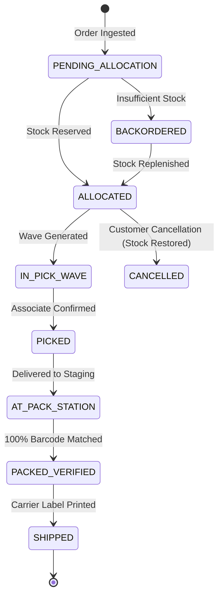
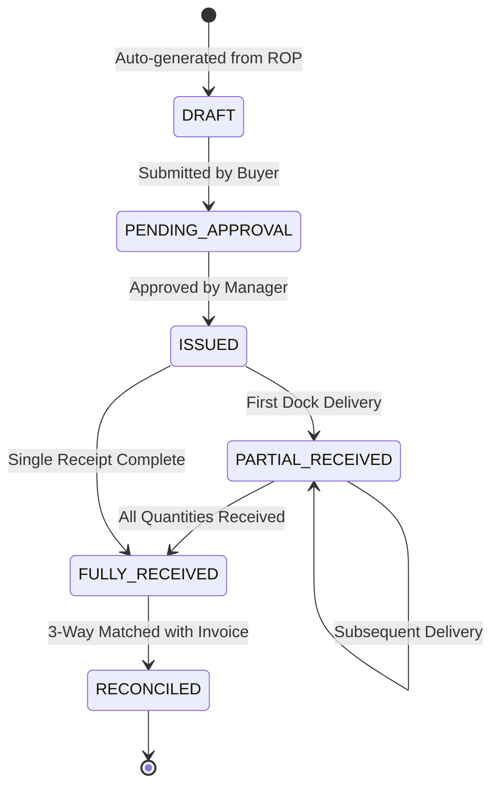

# BirrStock IMS: System Architecture & Technical Specification

This document provides the technical design, entity-relationship models, concurrency algorithms, and hardware integration specifications for **BirrStock**.

---

## 1. High-Level System Architecture

```mermaid
flowchart TB
    subgraph Client_Layer [Client Applications - Next.js App Router]
        AdminUI[Desktop Admin & Ops Portal<br/>Next.js Server Components]
        PackStation[Packing Station UI<br/>WebUSB / ZPL Print Hook]
        MobilePWA[Handheld Scanner PWA<br/>Camera Barcode / Keyboard Wedge]
    end

    subgraph Gateway_Layer [API & Microservices Layer - Node.js / NestJS]
        Gateway[API Gateway / Auth Guard / RBAC]
        AllocService[Order Allocation Service]
        LedgerService[Inventory Ledger Service]
        WMSWorker[Warehouse Ops Service]
        SyncService[Channel Sync Service]
    end

    subgraph Messaging_Concurrency [Async & Lock Layer]
        RedisCache[(Redis: Master Sessions & Cache)]
        RedlockManager[Redis Redlock: SKU Allocation Locks]
        BullMQCluster[BullMQ: Debounced Channel Sync & Webhooks]
    end

    subgraph Persistence_Layer [Database Layer]
        PostgreSQL[(PostgreSQL 16: Primary DB)]
        TimescaleExt[(TimescaleDB / Partitioned Ledger)]
    end

    subgraph External_Integrations [External APIs & Devices]
        ShopifyAPI[Shopify / Marketplace Webhooks]
        Carriers[FedEx / UPS / EasyPost API]
        Printers[Zebra / Rollo Thermal Printers (ZPL)]
    end

    Client_Layer -->|HTTPS / WSS| Gateway
    Gateway --> AllocService & LedgerService & WMSWorker & SyncService
    AllocService --> RedlockManager
    AllocService --> BullMQCluster
    LedgerService --> PostgreSQL
    WMSWorker --> PostgreSQL
    SyncService --> BullMQCluster
    BullMQCluster --> ShopifyAPI
    AllocService --> Carriers
    PackStation -.->|WebUSB / Raw TCP| Printers
```

---

## 2. Core Relational Database Schema (PostgreSQL DDL)

### 2.1 Catalog & Product Hierarchy
```sql
-- Base Product
CREATE TABLE products (
    id UUID PRIMARY KEY DEFAULT gen_random_uuid(),
    title VARCHAR(255) NOT NULL,
    description TEXT,
    category VARCHAR(100),
    is_active BOOLEAN DEFAULT TRUE,
    created_at TIMESTAMPTZ DEFAULT NOW(),
    updated_at TIMESTAMPTZ DEFAULT NOW()
);

-- Variant (SKU Level)
CREATE TABLE product_variants (
    id UUID PRIMARY KEY DEFAULT gen_random_uuid(),
    product_id UUID NOT NULL REFERENCES products(id) ON DELETE RESTRICT,
    sku VARCHAR(64) UNIQUE NOT NULL,
    title VARCHAR(255) NOT NULL,
    weight_grams INT DEFAULT 0,
    length_mm INT DEFAULT 0,
    width_mm INT DEFAULT 0,
    height_mm INT DEFAULT 0,
    unit_cost_cents INT NOT NULL DEFAULT 0, -- Stored in lowest currency denomination
    is_bundle BOOLEAN DEFAULT FALSE,
    created_at TIMESTAMPTZ DEFAULT NOW()
);
CREATE INDEX idx_variants_sku ON product_variants(sku);

-- Variant Barcodes (1 SKU can have many valid barcodes: UPC, EAN, internal)
CREATE TABLE product_barcodes (
    id UUID PRIMARY KEY DEFAULT gen_random_uuid(),
    variant_id UUID NOT NULL REFERENCES product_variants(id) ON DELETE CASCADE,
    barcode VARCHAR(64) UNIQUE NOT NULL,
    barcode_type VARCHAR(20) DEFAULT 'UPC', -- UPC, EAN, CODE128, QR
    is_primary BOOLEAN DEFAULT FALSE
);
CREATE INDEX idx_barcodes_value ON product_barcodes(barcode);

-- Virtual Bundles (Bill of Materials)
CREATE TABLE product_bundle_components (
    id UUID PRIMARY KEY DEFAULT gen_random_uuid(),
    bundle_variant_id UUID NOT NULL REFERENCES product_variants(id) ON DELETE CASCADE,
    component_variant_id UUID NOT NULL REFERENCES product_variants(id) ON DELETE RESTRICT,
    quantity_multiplier INT NOT NULL DEFAULT 1,
    CONSTRAINT chk_qty_pos CHECK (quantity_multiplier > 0)
);
```

---

### 2.2 Warehouse Layout & Physical Bins
```sql
CREATE TABLE warehouses (
    id UUID PRIMARY KEY DEFAULT gen_random_uuid(),
    code VARCHAR(16) UNIQUE NOT NULL, -- e.g., 'WH-EAST-01'
    name VARCHAR(128) NOT NULL,
    address JSONB NOT NULL,
    is_active BOOLEAN DEFAULT TRUE
);

CREATE TABLE warehouse_bins (
    id UUID PRIMARY KEY DEFAULT gen_random_uuid(),
    warehouse_id UUID NOT NULL REFERENCES warehouses(id) ON DELETE CASCADE,
    zone VARCHAR(16) NOT NULL,   -- e.g., 'ZONE-A'
    aisle VARCHAR(16) NOT NULL,  -- e.g., 'AISLE-03'
    rack VARCHAR(16) NOT NULL,   -- e.g., 'RACK-02'
    shelf VARCHAR(16) NOT NULL,  -- e.g., 'SHELF-1'
    bin_code VARCHAR(32) UNIQUE NOT NULL, -- e.g., 'WH1-ZA-A03-R02-S1-B04'
    is_pickable BOOLEAN DEFAULT TRUE,
    is_dock BOOLEAN DEFAULT FALSE,
    is_quarantine BOOLEAN DEFAULT FALSE,
    max_weight_grams INT,
    pick_priority INT DEFAULT 100 -- Used by path optimizer
);
CREATE INDEX idx_bins_code ON warehouse_bins(bin_code);
```

---

### 2.3 Immutable Inventory Transaction Ledger
```sql
-- Every single stock delta is recorded here. Never edited or deleted.
CREATE TABLE inventory_transactions (
    id UUID PRIMARY KEY DEFAULT gen_random_uuid(),
    variant_id UUID NOT NULL REFERENCES product_variants(id),
    warehouse_id UUID NOT NULL REFERENCES warehouses(id),
    source_bin_id UUID REFERENCES warehouse_bins(id),
    destination_bin_id UUID REFERENCES warehouse_bins(id),
    delta_quantity INT NOT NULL, -- Positive for inbound/gain, negative for outbound/loss
    reason_code VARCHAR(64) NOT NULL, -- 'PO_RECEIPT', 'ORDER_PICK', 'TRANSFER', 'CYCLE_COUNT_ADJUST', 'RMA_RESTOCK'
    reference_type VARCHAR(32), -- 'PURCHASE_ORDER', 'SALES_ORDER', 'RMA', 'COUNT_TASK'
    reference_id VARCHAR(64),
    performed_by UUID NOT NULL, -- references users(id)
    notes TEXT,
    created_at TIMESTAMPTZ DEFAULT NOW()
);
CREATE INDEX idx_ledger_variant_warehouse ON inventory_transactions(variant_id, warehouse_id);
CREATE INDEX idx_ledger_created_at ON inventory_transactions(created_at);

-- Materialized Stock Balance (Fast O(1) Reads)
CREATE TABLE inventory_balances (
    id UUID PRIMARY KEY DEFAULT gen_random_uuid(),
    variant_id UUID NOT NULL REFERENCES product_variants(id),
    warehouse_id UUID NOT NULL REFERENCES warehouses(id),
    bin_id UUID NOT NULL REFERENCES warehouse_bins(id),
    quantity_on_hand INT NOT NULL DEFAULT 0,
    quantity_reserved INT NOT NULL DEFAULT 0,
    updated_at TIMESTAMPTZ DEFAULT NOW(),
    CONSTRAINT uq_variant_bin UNIQUE(variant_id, bin_id),
    CONSTRAINT chk_balances_non_negative CHECK (quantity_on_hand >= 0 AND quantity_reserved >= 0)
);
CREATE INDEX idx_balances_lookup ON inventory_balances(variant_id, warehouse_id);
```

---

### 2.4 Sales Orders & Allocations
```sql
CREATE TABLE sales_orders (
    id UUID PRIMARY KEY DEFAULT gen_random_uuid(),
    external_order_id VARCHAR(128) NOT NULL, -- Shopify order ID
    channel_name VARCHAR(64) NOT NULL,       -- 'SHOPIFY_US', 'AMAZON_US'
    status VARCHAR(32) NOT NULL DEFAULT 'PENDING_ALLOCATION',
    -- Statuses: PENDING_ALLOCATION, ALLOCATED, PICKING, PACKED, SHIPPED, CANCELLED
    shipping_address JSONB NOT NULL,
    created_at TIMESTAMPTZ DEFAULT NOW(),
    updated_at TIMESTAMPTZ DEFAULT NOW()
);
CREATE INDEX idx_orders_status ON sales_orders(status);

CREATE TABLE order_items (
    id UUID PRIMARY KEY DEFAULT gen_random_uuid(),
    order_id UUID NOT NULL REFERENCES sales_orders(id) ON DELETE CASCADE,
    variant_id UUID NOT NULL REFERENCES product_variants(id),
    quantity_ordered INT NOT NULL,
    unit_price_cents INT NOT NULL
);

CREATE TABLE order_allocations (
    id UUID PRIMARY KEY DEFAULT gen_random_uuid(),
    order_id UUID NOT NULL REFERENCES sales_orders(id),
    order_item_id UUID NOT NULL REFERENCES order_items(id),
    variant_id UUID NOT NULL REFERENCES product_variants(id),
    warehouse_id UUID NOT NULL REFERENCES warehouses(id),
    allocated_quantity INT NOT NULL,
    status VARCHAR(32) DEFAULT 'ACTIVE', -- ACTIVE, RELEASED, FULFILLED
    created_at TIMESTAMPTZ DEFAULT NOW()
);
```

---

## 3. High-Concurrency Stock Allocation Engine

To prevent race conditions when two customers buy the last remaining stock simultaneously, BirrStock uses a two-tier locking model: **Redis Distributed Lock (Redlock)** for low-latency queue serialization + **PostgreSQL Row-Level Locking** for database ACID integrity.

### 3.1 Node.js Allocation Algorithm (TypeScript)
```typescript
import { Injectable, ConflictException } from '@nestjs/common';
import { DataSource } from 'typeorm';
import Redis from 'ioredis';

@Injectable()
export class InventoryAllocationService {
  constructor(
    private readonly dataSource: DataSource,
    private readonly redis: Redis,
  ) {}

  async allocateOrderStock(orderId: string, items: { sku: string; variantId: string; qty: number }[], warehouseId: string) {
    // 1. Acquire Redis locks for all SKUs ordered (sorted alphabetically to prevent deadlocks)
    const sortedSkus = [...items].sort((a, b) => a.sku.localeCompare(b.sku));
    const lockKeys = sortedSkus.map(i => `lock:stock:${warehouseId}:${i.variantId}`);
    const lockTokens: string[] = [];

    try {
      for (const key of lockKeys) {
        const token = Math.random().toString(36).substring(2);
        // Acquire lock with 5000ms TTL
        const acquired = await this.redis.set(key, token, 'PX', 5000, 'NX');
        if (!acquired) {
          throw new ConflictException(`Inventory currently congested for SKU. Retrying...`);
        }
        lockTokens.push(token);
      }

      // 2. Perform atomic database transaction with Row-Level Locking
      return await this.dataSource.transaction(async (manager) => {
        for (const item of items) {
          // Lock the balance row in PostgreSQL
          const balance = await manager.query(
            `SELECT id, quantity_on_hand, quantity_reserved 
             FROM inventory_balances 
             WHERE variant_id = $1 AND warehouse_id = $2
             FOR UPDATE`,
            [item.variantId, warehouseId]
          );

          if (!balance.length) {
            throw new ConflictException(`No inventory record found for SKU: ${item.sku}`);
          }

          const available = balance[0].quantity_on_hand - balance[0].quantity_reserved;
          if (available < item.qty) {
            throw new ConflictException(`Insufficient stock for SKU: ${item.sku}. Available: ${available}, Requested: ${item.qty}`);
          }

          // Atomically increment reserved count
          await manager.query(
            `UPDATE inventory_balances 
             SET quantity_reserved = quantity_reserved + $1, updated_at = NOW() 
             WHERE id = $2`,
            [item.qty, balance[0].id]
          );

          // Insert allocation record
          await manager.query(
            `INSERT INTO order_allocations (order_id, variant_id, warehouse_id, allocated_quantity, status)
             VALUES ($1, $2, $3, $4, 'ACTIVE')`,
            [orderId, item.variantId, warehouseId, item.qty]
          );
        }

        // Mark order as ALLOCATED
        await manager.query(`UPDATE sales_orders SET status = 'ALLOCATED' WHERE id = $1`, [orderId]);
        return { success: true, orderId };
      });
    } finally {
      // 3. Release all acquired Redis locks safely via Lua script
      for (let i = 0; i < lockKeys.length; i++) {
        const key = lockKeys[i];
        const token = lockTokens[i];
        const releaseScript = `
          if redis.call("get", KEYS[1]) == ARGV[1] then
            return redis.call("del", KEYS[1])
          else
            return 0
          end
        `;
        await this.redis.eval(releaseScript, 1, key, token);
      }
    }
  }
}
```

---

## 4. Hardware Barcode Scanner Integration (Next.js Hook)

In warehouse operations, barcode scanners operate in **Keyboard Wedge Mode** (acting as ultra-fast virtual keyboards sending keystrokes followed by an `Enter` key). 

Warehouse workers cannot be expected to click into an input box before every scan. The following custom Next.js React hook captures global barcode input instantly.

### 4.1 React Scanner Hook (`useBarcodeScanner.ts`)
```typescript
'use client';

import { useEffect, useRef } from 'react';

interface ScannerOptions {
  onScan: (scannedValue: string) => void;
  minChars?: number;
  maxIntervalMs?: number; // Scanners input characters in < 25-40ms intervals
}

export function useBarcodeScanner({
  onScan,
  minChars = 5,
  maxIntervalMs = 50,
}: ScannerOptions) {
  const bufferRef = useRef<string>('');
  const lastKeyTimeRef = useRef<number>(0);

  useEffect(() => {
    const handleKeyDown = (e: KeyboardEvent) => {
      // Ignore if user is intentionally typing into a standard text input or textarea
      const target = e.target as HTMLElement;
      if (target.tagName === 'INPUT' || target.tagName === 'TEXTAREA') {
        if (!target.classList.contains('scanner-listening')) {
          return;
        }
      }

      const currentTime = performance.now();
      const timeDiff = currentTime - lastKeyTimeRef.current;
      lastKeyTimeRef.current = currentTime;

      // Enter key indicates end of barcode transmission
      if (e.key === 'Enter') {
        if (bufferRef.current.length >= minChars) {
          e.preventDefault();
          const code = bufferRef.current.trim();
          bufferRef.current = '';
          onScan(code);
        } else {
          bufferRef.current = '';
        }
        return;
      }

      // If typing speed is too slow (>50ms between keys), it's human typing: reset buffer
      if (timeDiff > maxIntervalMs) {
        bufferRef.current = '';
      }

      // Only accumulate printable single characters
      if (e.key.length === 1) {
        bufferRef.current += e.key;
      }
    };

    window.addEventListener('keydown', handleKeyDown);
    return () => window.removeEventListener('keydown', handleKeyDown);
  }, [onScan, minChars, maxIntervalMs]);
}
```

---

## 5. Direct Thermal Label Printing (Zero-Click)

To eliminate browser print dialog popups and print directly to thermal label printers (Zebra, Rollo) in under 1 second:

### 5.1 Architecture: WebUSB & Local Print Agent
1. **WebUSB API (Modern Chrome on Next.js):** Connect directly to USB thermal printers supporting ZPL commands from the client browser.
2. **QZ Tray / Local Print Daemon:** A lightweight background service running on packing station PCs listening on `localhost:8182` (WebSocket) to dispatch raw ZPL or PDF binaries to CUPS / Windows Spooler.

### 5.2 ZPL Template Sample for 4x6 Shipping Label
```text
^XA
^FO50,50^A0N,40,40^FDEXPRESS PRIORITY SHIPPING^FS
^FO50,110^GB700,3,3^FS
^FO50,130^A0N,28,28^FDShip To:^FS
^FO50,165^A0N,32,32^FDJane Doe^FS
^FO50,205^A0N,28,28^FD123 E-Commerce Blvd, Suite 400^FS
^FO50,240^A0N,28,28^FDNew York, NY 10001^FS
^FO50,290^GB700,3,3^FS
^FO100,320^BY3,3,100^BCN,140,Y,N,N^FDTRACKING: 9400111202555029199^FS
^FO50,500^A0N,30,30^FDOrder: SO-2026-9901^FS
^FO50,540^A0N,25,25^FDPacked By: Station 03 - BirrStock IMS^FS
^XZ
```

---

## 6. System State Machines

### 6.1 Order Fulfillment Lifecycle


### 6.2 Purchase Order (Inbound) Lifecycle

