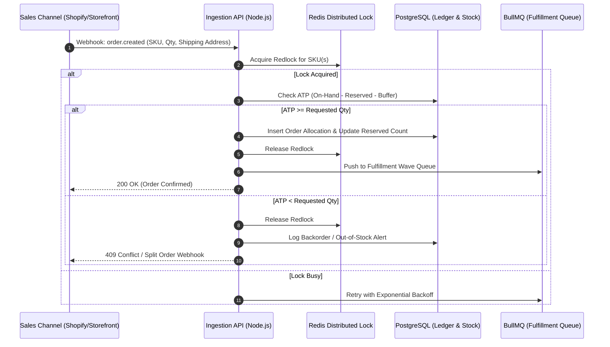

# BirrStock IMS: Detailed Use Cases Specification

This document details the primary business use cases for the internal enterprise e-commerce Inventory Management System.

---

## UC-01: Inbound Receiving and Purchase Order (PO) Reconciliation

* **Primary Actor:** Warehouse Associate
* **Supporting Actors:** Procurement Specialist, System (Auto-ledger)
* **Preconditions:** A Purchase Order exists in status `ISSUED` or `PARTIALLY_RECEIVED`. Vendor shipment has arrived at the receiving dock.

### Main Success Scenario
1. Associate scans the PO number barcode on the packing slip or searches the PO in the Next.js Receiving portal.
2. The system loads the expected items, quantities, and vendor details.
3. Associate scans the first product barcode (UPC/EAN/SKU).
4. System highlights the matched line item, plays an audio confirmation tone, and prompts for received quantity and lot/batch code.
5. Associate enters received quantity or performs continuous piece-by-piece scanning.
6. System compares received count against expected PO quantity:
   - If received count equals PO quantity, the line item marks as `RECEIVED_FULL`.
   - If received count is less than PO quantity, the line item marks as `PARTIAL_RECEIVED`.
7. Associate completes receiving.
8. System executes an atomic database transaction:
   - Updates PO status (`RECEIVED` or `PARTIALLY_RECEIVED`).
   - Appends records to the `inventory_transactions` ledger with status `DOCK_RECEIVING_BIN`.
   - Dispatches a webhook to Procurement with discrepancy notes if any.

### Extensions (Alternative Flows)
* **3a. Unrecognized Barcode / SKU not on PO:**
  * System alerts with an error audio tone. Associate can flag the item as "Unexpected / Over-shipment". Item is placed in a quarantine holding area pending Procurement approval.
* **6a. Damaged Goods Detected:**
  * Associate taps "Flag Damaged", enters damaged quantity, and uploads a photo using the handheld scanner camera.
  * System records damaged units under `DAMAGED_QUARANTINE` status (not added to Available-to-Promise stock).

---

## UC-02: Guided Putaway and Bin Location Assignment

* **Primary Actor:** Warehouse Associate
* **Preconditions:** Items have been received at the dock (`DOCK_RECEIVING_BIN`).

### Main Success Scenario
1. Associate scans a cart or pallet ID containing dock-received goods.
2. System calculates and displays the optimal destination bin location based on:
   - Velocity code (Fast-moving ABC Category "A" items placed near packing stations).
   - Existing stock consolidation (placing items where matching SKU already resides).
   - Physical bin size and weight constraints.
3. Associate navigates to the suggested aisle and shelf.
4. Associate scans the destination bin barcode (e.g., `WH1-Z01-A02-R01-B03`).
5. Associate scans the item barcode and confirms quantity placed.
6. System moves stock from `DOCK_RECEIVING_BIN` to the confirmed bin location in the inventory ledger.
7. Available-to-Promise (ATP) inventory increases and channel sync workers are notified.

### Extensions
* **4a. Suggested Bin is Full:**
  * Associate taps "Bin Full / Override".
  * Associate scans an alternate empty or compatible bin.
  * System logs the override and updates the item's location map.

---

## UC-03: Real-Time Omnichannel Order Allocation and Reservation

* **Primary Actor:** Automated System (E-commerce Order Ingestion Engine)
* **Supporting Actors:** Customer (via Storefront), E-commerce Ops Manager
* **Preconditions:** New order received from sales channel (Shopify, Amazon, or Internal Storefront).

### Main Success Scenario
1. E-commerce webhook delivers order payload with SKUs, quantities, and destination postal code.
2. Node.js backend acquires a distributed Redis lock (`sku_allocation_lock:<sku>`) to guarantee serial consistency.
3. System runs the Allocation Routing Algorithm:
   - Identifies warehouses possessing available stock.
   - Evaluates lowest shipping zone/cost or single-shipment fulfillment preference.
4. System creates an entry in `order_allocations` table and increments `quantity_reserved`.
5. System releases the Redis lock.
6. BullMQ triggers inventory balance re-calculation. If remaining stock crosses a safety threshold, a channel sync event is queued to update external sales channels.

---

## UC-04: Wave / Batch Picking via Handheld Scanner

* **Primary Actor:** Warehouse Associate
* **Preconditions:** Multiple orders have been released for fulfillment and batched into a pick wave.

### Main Success Scenario
1. Associate logs into the Next.js Handheld PWA and selects "Start New Pick Wave".
2. System groups 20 single-line orders into a single batch and generates a serially sequenced pick path (S-shape / Snake routing through aisles to minimize steps).
3. The screen displays the first location: `Zone A -> Aisle 3 -> Shelf 2 -> Bin 04`.
4. Associate walks to the bin and scans the bin barcode.
5. System verifies bin barcode match:
   - If incorrect: Emits loud rejection buzzer sound and vibrates phone.
   - If correct: Prompts to scan item SKU and shows quantity to pick (e.g., "Pick 4 units of SKU-1002").
6. Associate scans item barcode. Item count increments.
7. Associate places picked units into designated batch tote/cart slot.
8. System directs associate to the next sequential location until the wave is 100% picked.
9. Associate delivers the tote to the Packing Station and scans the tote into `STAGING_PACK_ZONE`.

---

## UC-05: Packing Station Barcode Verification and Direct Label Printing

* **Primary Actor:** Pack Station Specialist
* **Supporting Actors:** Shipping Carrier API (FedEx, UPS, DHL), Thermal Label Printer
* **Preconditions:** Pick wave tote has arrived at the packing station.

### Main Success Scenario
1. Specialist scans the tote barcode or order invoice number.
2. Next.js Packing Station UI displays the order details, required items, and thumbnail images.
3. Specialist scans each physical item barcode being placed into the shipping box.
4. System verifies that scanned item and quantity strictly match the packing manifest:
   - Packing slip button and shipping label button remain disabled until all items match 100%.
5. Specialist places packed box on digital scale (or inputs package dimensions and weight).
6. Specialist selects shipping carrier (or system auto-selects cheapest method meeting delivery SLA).
7. System calls carrier API to generate tracking number and shipping label payload.
8. System sends raw ZPL (Zebra Programming Language) directly to the local thermal printer via WebUSB or background print agent (no browser print dialog modal).
9. Label prints instantly (sub-second).
10. Order status updates to `PACKED_AND_LABELED`. Stock moves from `RESERVED` to `FULFILLED_SHIPPED` in the ledger.

---

## UC-06: Customer Returns (RMA) Processing and Item Grading

* **Primary Actor:** Returns Specialist
* **Supporting Actors:** Customer Service, Storefront Platform
* **Preconditions:** Returned package received from customer with RMA tracking label or order number.

### Main Success Scenario
1. Specialist scans customer return tracking label or enters Order Number.
2. System displays original order items, return reasons selected by customer, and return authorization status.
3. Specialist inspects physical item and selects an **Inspection Grade**:
   * **Grade A (Pristine / Unopened):** Complete original packaging, tags attached, no wear.
   * **Grade B (Open Box / Cosmetic Blemish):** Functional, missing tags/box; designated for resale on liquidation or outlet channels.
   * **Grade C (Damaged / Defective / Unsellable):** Written off or sent to parts salvage.
4. Specialist scans target destination bin based on grade:
   - Grade A $\rightarrow$ Standard pick bin (immediately increments Available-to-Promise stock).
   - Grade B $\rightarrow$ Secondary outlet storage bin.
   - Grade C $\rightarrow$ Quarantine / Write-off bin.
5. System records return in the inventory ledger with disposition reason.
6. System fires webhook to e-commerce storefront to trigger refund or store credit release.

---

## UC-07: Continuous Cycle Counting and Discrepancy Reconciliation

* **Primary Actor:** Inventory Controller
* **Supporting Actors:** Warehouse Floor Associate, VP of Operations
* **Preconditions:** Scheduled cycle count triggered by system (ABC velocity rule) or ad-hoc count requested.

### Main Success Scenario
1. System generates a daily "Blind Cycle Count" task list for high-turnover Category A SKUs.
2. Associate navigates to target bin and scans the bin barcode.
3. Associate counts physical items and enters quantity counted (System performs a **blind count**: associate cannot see the expected system quantity).
4. System compares counted value against ledger book quantity:
   - **Match:** Count marked verified; next count scheduled per rotation.
   - **Discrepancy:** System prompts associate to immediately recount.
5. If discrepancy persists, system logs a `RECONCILIATION_PENDING` ticket with calculated financial variance ($\Delta \text{Qty} \times \text{Unit Cost}$).
6. If financial variance is below \$100, Inventory Controller approves with one click.
7. If financial variance is above \$100, escalation requires VP of Operations signature.
8. Upon approval, system creates a balancing adjustment in `inventory_transactions` (`ADJUSTMENT_CYCLE_COUNT_GAIN` or `LOSS`).

---

## UC-08: Channel Stock Synchronization and Buffer Management

* **Primary Actor:** Automated System (Channel Sync Worker)
* **Supporting Actors:** E-commerce Ops Manager
* **Preconditions:** Inventory quantity on-hand, reserved, or buffer settings change.

### Main Success Scenario
1. Stock update event is published to `channel_sync_events` stream.
2. Channel Worker groups events by SKU with a 5-second debounce window to prevent API throttling during high-velocity checkout periods.
3. For each active sales channel (Shopify, Amazon, etc.), worker calculates channel-specific stock:
   $$\text{Channel Stock} = \max\left(0, \text{ATP} - \text{Channel Buffer}\right)$$
4. System formats channel-specific payloads (e.g., Shopify Inventory Adjust API, Amazon SP-API).
5. System executes API call with retry policy (exponential backoff).
6. Success response logs sync timestamp in `channel_inventory_states` table.

---

## UC-09: Automated Reorder Triggers and Landed Cost Tracking

* **Primary Actor:** Procurement Specialist
* **Preconditions:** Stock level for a SKU falls below calculated Reorder Point (ROP).

### Main Success Scenario
1. Nightly cron job calculates reorder thresholds using formula:
   $$\text{ROP} = (\text{Average Daily Sales} \times \text{Vendor Lead Time in Days}) + \text{Safety Stock}$$
2. For SKUs where $\text{On-Hand} + \text{On-Order} \le \text{ROP}$, system auto-drafts a Purchase Order for the Economic Order Quantity (EOQ).
3. Procurement Specialist reviews drafted POs in the Next.js procurement portal.
4. Specialist confirms vendor, negotiated unit price, and submits PO.
5. Upon vendor delivery, freight and customs invoices are attached to the PO.
6. System calculates **Landed Cost per unit**:
   $$\text{Unit Landed Cost} = \text{Unit PO Price} + \frac{\text{Total Freight + Duties + Insurance}}{\text{Total Units Received}}$$
7. Item master valuation is updated to reflect true cost of goods sold (COGS).
